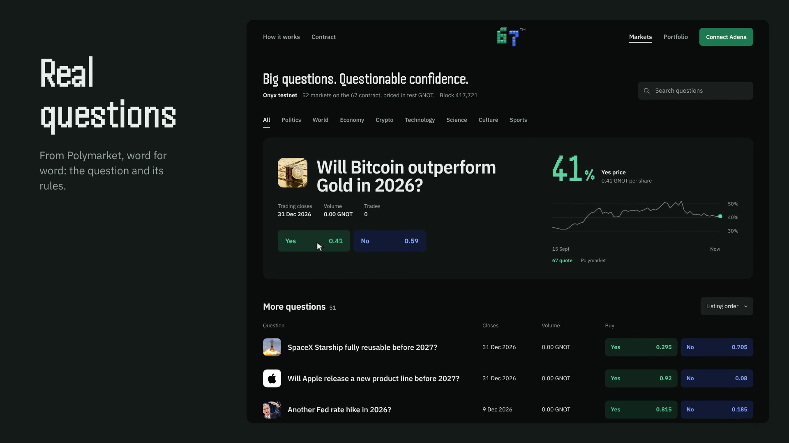
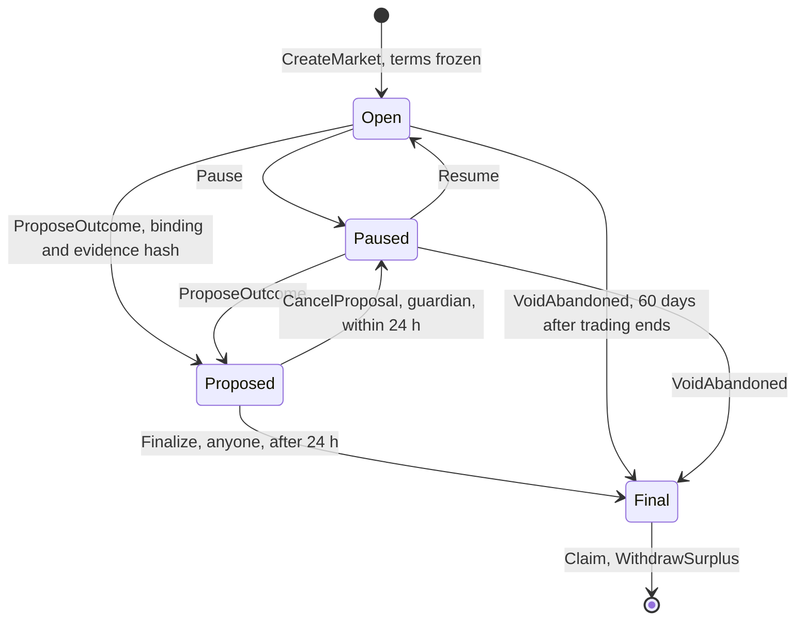

# 67 (Six Seven)

Prediction markets on Gno.land with frozen terms, collateral checks and outcome evidence anyone can recompute from Polygon.

[Follow one market on Onyx](https://onyx.testnets.gno.land/r/nym-sixseven067/markets/v2:nfl-car-phi-2026-10-18) · [Open markets](https://the67.click/#/markets) · [52-second walkthrough](https://dintsen.agency/assets/videos/six-seven-67/walkthrough.mp4) · [67 on Gno.land](https://onyx.testnets.gno.land/r/nym-sixseven067/home) · [Gnome Tavern entry](https://dorahacks.io/build/52004)

[](https://dintsen.agency/assets/videos/six-seven-67/walkthrough.mp4)

## Verify it in one minute

1. Open [Panthers vs. Eagles in Gnoweb](https://onyx.testnets.gno.land/r/nym-sixseven067/markets/v2:nfl-car-phi-2026-10-18). The realm renders the question, the rules hash, the Polymarket condition, the oracle and the record fixed at listing.
2. Open the [purchase receipt](https://rpc.onyx.testnets.gno.land/tx?hash=0xA5F90CB7C145443E6C153913967161EF2043C4482FA0C275BC97CC6E29F4C3DA), block 432,668: `Bought` 6.208566 shares at 0.635 GNOT, cost 3.942440 plus fee 0.057560 test GNOT.
3. Open the [proposal receipt](https://rpc.onyx.testnets.gno.land/tx?hash=0xFB22504649D26C75A625A518F3E792CCFD50F6FA0249844EC04E5563D304C767), block 1,442,078: `OutcomeProposed` with evidence hash `f587f7466219…7f1d`, final from 28 November 2026, 03:51:17 UTC. The same transaction also finalized three Markets v1 questions.
4. Recompute the hash from the [published evidence records](docs/ONYX-V2-EVIDENCE.json) with the command in [docs/ONYX-EVIDENCE.md](docs/ONYX-EVIDENCE.md). Two Polygon RPCs return the payout vector `[1, 0] / 1` for the bound condition.

The walkthrough's purchase and payout scenes run in a controlled test environment; the receipts above come from the live realm.

## How a market works

A market fixes its question, rules and outcome binding in Gno. The app shows 67's own quotes alongside Polymarket reference prices. Adena signs the testnet purchase, and the Gno realm verifies the reviewed quote, exact payment and available collateral. After the oracle's proposal survives the 24-hour review, a winning share pays one test GNOT.



The markets are independent positions on Gno.land. Polymarket supplies reference prices and market metadata. Resolution relies on a designated oracle and an evidence commitment: the realm checks the binding and records the hash, and anyone can recompute it off chain, as described in the [contract documentation](contracts/README.md).

## What the realm guarantees

| Guarantee | Where Markets v2 enforces it |
| --- | --- |
| A purchase executes only at the price the buyer reviewed, and only while the quote is fresh | [`Buy`](contracts/v2/markets.gno#L420) checks the [quote's age](contracts/v2/markets.gno#L428) and the [reviewed price](contracts/v2/markets.gno#L430) |
| Exact payment and full collateral | The payment must equal [cost plus fee](contracts/v2/markets.gno#L434); the market's escrow must [cover its larger side](contracts/v2/markets.gno#L449) |
| An outcome is bound to the listed market | [`ProposeOutcome`](contracts/v2/markets.gno#L480) must restate the [condition, rules hash and token IDs](contracts/v2/markets.gno#L486) and carry an evidence hash |
| Time to object | The guardian can [cancel a proposal](contracts/v2/markets.gno#L498) for [24 hours](contracts/v2/markets.gno#L37); then anyone can [finalize](contracts/v2/markets.gno#L512) |
| Winners and Void holders are paid from escrow | [`Claim`](contracts/v2/markets.gno#L550) pays 1 GNOT per winning share, or refunds cost and fee on Void |
| A stuck market cannot hold funds forever | [`VoidAbandoned`](contracts/v2/markets.gno#L524) voids it 60 days after trading ends |

Markets v1 is the earlier contract: it has the binding and collateral checks, but no fee, quote expiry or review window.

## Who holds which role today

On testnet every role belongs to the project: a robot key quotes and lists, results come from the owner's oracle key or a robot oracle that reads Polygon, and an operator key is the guardian. Roles change hands in two steps on chain ([`ProposeRole`](contracts/v2/markets.gno#L184), then [`AcceptRole`](contracts/v2/markets.gno#L205)), so the guardian can move to an independent party without a redeploy.

## Onyx deployment

| Realm | Source | Deployment |
| --- | --- | --- |
| Markets v2 | [contracts/v2](contracts/v2) | [Markets v2 on Onyx](https://onyx.testnets.gno.land/r/nym-sixseven067/markets/v2) |
| Markets v1 | [contracts](contracts) | [Markets on Onyx](https://onyx.testnets.gno.land/r/nym-sixseven067/markets) |
| Gnoweb home | [contracts/home](contracts/home) | [67 on Onyx](https://onyx.testnets.gno.land/r/nym-sixseven067/home) |

Chain `onyx-1`. [Verify Onyx receipts](docs/ONYX-EVIDENCE.md) for an executed purchase, oracle finality and a voided market. The frontend reads both market realms.

## Run

Node.js 22 or 24 and npm:

```sh
npm ci
npm run dev        # http://127.0.0.1:6767
```

Routes: `#/` (home), `#/how` (how it works, with a purchase calculator), `#/contract` (every realm function and its refusals), `#/markets`, `#/market/<id>`, `#/polymarket/<condition ID>` (a Polymarket market not on 67, read-only), `#/portfolio`, `#/status` (the operator's page). Search and topic filters live in the Markets hash query.

The home page shows a balance in a night voxel forest (three.js, loaded lazily after first paint). Its glass cubes split by the live Yes price, the beam tilts toward the dearer side and each pile's glow follows its price. Devices without a GPU or WebGL keep a still of the same forest (`public/forest-night.webp`); reduced motion draws one still frame; the price is always text. Design direction: [docs/design/DIRECTION.md](docs/design/DIRECTION.md) (V6: dark glass, cube mark).

Production build and preview:

```sh
npm run build
npm run preview -- --strictPort
```

Testnet trading needs the page on an `http(s)` origin with the Adena extension. `67.html` (see Packaging) opens directly from disk for review and reads the public Onyx RPC, indexer and Polymarket, but browser extensions usually do not inject into `file:` pages.

## Testnet trading

1. Connect Adena. If Adena is on another network, the ticket offers **Switch to Onyx testnet** (Adena may ask to add it first).
2. Get test GNOT from the [faucet](https://faucet.gno.land) if needed.
3. Choose an outcome (Yes or No, or a team in a match market), enter an amount in GNOT and review. The review shows exact shares, the exact ugnot you pay, the payout if you win and the contract path.
4. Confirm in Adena. The trade counts as confirmed only when the contract shows the new position; an answer that never lands becomes **Result not confirmed yet** with **Check again**, never a silent retry.
5. When a market is final, winning positions show **Claim** in Portfolio.

The contract refuses a purchase whose price differs from the review, whose payment is not exact, or that the market's collateral cannot cover. The interface explains each refusal and asks for a new review.

## Backend and contracts

- [Gno realm](contracts/README.md): collateral, fixed versioned quotes, positions, oracle finalization, claims, events and JSON projections.
- [Operations](ops/README.md): namespace registration, deployment, market seeding, funding, administrator handover and oracle finalization.
- [Gateway](docs/BACKEND.md): optional local read-only service for Onyx accounts and Polymarket source inspection. The browser app reads the chain directly and does not need it.
- [Oracle proposals](docs/ORACLE.md): unsigned resolution proposals for the four bound markets in `server/bindings.json`.
- [Gno MCP](docs/MCP.md): pinned gnomcp 0.12.0 used for deployment and chain checks.

## Checks

```sh
npm run typecheck
npm test                      # Adena, chain layer, Polymarket readers, oracle, gateway, proposals
npm run build
npm run qa:e2e                # browser suites on a controlled testnet (mock Onyx, Adena, Polymarket, Polygon)
(cd contracts && gno test . && gno test ./v2 && gno test ./home)   # 27 v1, 31 v2 and 2 home tests; see contracts/README.md
```

`e2e/local-chain.spec.ts` runs the real purchase path against a local gnoland node when `GNO_LOCAL_RPC`, `GNO_LOCAL_REALM` and `GNOMCP` are set; it is skipped otherwise. Evidence and remaining gaps are in [QA.md](QA.md).

## Packaging

```sh
STANDALONE=1 npx vite build              # one bundle, the 3D scene inlined
node scripts/package-standalone.mjs      # writes ../67.html and ../67-source.zip
node scripts/verify-standalone.mjs       # opens ../67.html: live markets, the mirror, a market page
```

## Stack

React 19.3, TypeScript 7.0, Vite 8.3, plain CSS, npm. Playwright 1.64 and axe-core for browser checks; Node's test runner for unit tests. No wallet SDK, UI kit or animation runtime: Adena is used through its injected provider and the chain through public JSON-RPC. Handjet, IBM Plex Sans and IBM Plex Mono are self-hosted under SIL OFL 1.1 ([Handjet](public/fonts/Handjet-OFL.txt), [IBM Plex Sans](public/fonts/IBMPlexSans-OFL.txt), [IBM Plex Mono](public/fonts/IBMPlexMono-OFL.txt)).

See [architecture](docs/ARCHITECTURE.md), [scenarios](docs/SCENARIOS.md), [direction](docs/design/DIRECTION.md) and [references](docs/design/REFERENCES.md).

## Roadmap

2027: automated quoting and oracle proposals with alerts, a published source policy and an esports pilot, then user-proposed markets reviewed before a community listing vote. Quarter by quarter, with the evidence each step must produce: [docs/ROADMAP.md](docs/ROADMAP.md).
